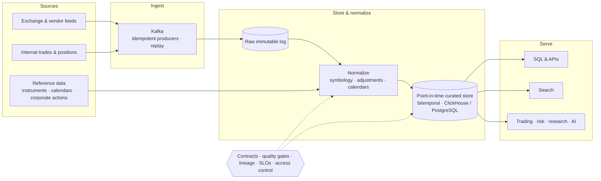

### Data Engineer | Market Data, AI & Quantitative Finance

 

 

> *Market and financial data that is correct, explainable, and recoverable.*

| **5B+** | **10M+** | **< 1s** | **🏆 1st** | **5+ yrs** |
|:---:|:---:|:---:|:---:|:---:|
| records on HA clusters | platform users served | search over streaming transaction data | FPT AI Hackathon 3 · 2025 (global) | industry data engineering |

---

## ◈ About Me

I'm a data engineer with **5+ years of industry data engineering**, focused on **market and financial data platforms** and based in the **Republic of Korea**. I design ingestion, storage, and delivery so that traders, risk teams, analysts, and downstream systems receive data that is **correct as of a point in time, explainable, and recoverable**.

My work includes **highly available ClickHouse / MongoDB / Redis clusters** holding **5B+ records**, **Spark** pipelines for a platform with **10M+ users**, **Kafka**-based streams of on-chain financial transactions, and an **Oracle → PostgreSQL** migration for an investment securities system.

I'm growing toward **Staff-level scope**: owning platform architecture across teams, setting the standards for how financial data is ingested, validated, and changed, and making the platform easier for other engineers to build on. An early career in credit risk modeling means I design for the people who *consume* the data, not just the pipelines that produce it.

---

## ◈ Where I Fit

| Focus | What I bring | Evidence |
|:---|:---|:---|
| **Market Data Engineering** | Real-time event ingestion · publish–subscribe fan-out · columnar storage for high-volume, time-ordered data · sub-second search | [BlockStream](#blockstream) · ClickHouse clusters |
| **Financial Data Engineering** | Highly available storage with disaster recovery · SQL migration that preserves business semantics · traceable, reconcilable records | [ABACUS](#abacus) · [Investment Securities](#investment-securities) |
| **Toward Staff DE** | Platform architecture ownership · standards and paved roads · safe change management · operational excellence | [Staff-Level Scope](#staff-scope) |
| **Supporting: AI Data Engineering** | Enterprise document → structured data pipelines · vector indexing · LLM enrichment | [AISOL 🏆](#aisol) |

---

## ◈ Staff-Level Scope: Platform & Technical Direction

A senior engineer makes a pipeline reliable. A staff engineer makes the **platform** reliable, so every team can ship correct market and financial data without solving the same problems again. That is the scope I'm building toward.

### Architecture ownership so far

| Decision area | What I owned | Where |
|:---|:---|:---|
| **Multi-store platform architecture** | HA ClickHouse, MongoDB, and Redis clusters for 5B+ records, with disaster recovery provisions | [ABACUS](#abacus) |
| **End-to-end streaming design** | Collection → Kafka fan-out → PostgreSQL persistence → OpenSearch / Algolia indexing, with sub-second search | [BlockStream](#blockstream) |
| **Database platform migration** | Oracle → EDB (PostgreSQL), rewriting SQL to ANSI while preserving securities business logic | [Investment Securities](#investment-securities) |
| **Throughput at scale** | Spark pipeline optimization for a platform serving 10M+ users | [ABACUS](#abacus) |
| **Requirements → data interfaces** | Turning securities business rules into SQL; building monitoring dashboards for platform operators | [Investment Securities](#investment-securities) · [ABACUS](#abacus) |

### How I lead platform work

1. **Architecture decisions in writing.** Design docs and ADRs that record the options, the tradeoffs (latency, throughput, cost, operational load), and the conditions that would reverse the decision.
2. **Paved roads over one-offs.** Reusable ingestion and normalization templates with deduplication, replay, backfill, and quality checks built in, so onboarding a new feed is configuration, not a new project.
3. **Data products with owners and SLOs.** Every critical dataset has an owner, a contract, and published freshness, completeness, and accuracy targets. Consumers know what to expect, and producers know what they are accountable for.
4. **Change without breakage.** Versioned schemas, parallel runs with reconciliation during migrations, and deprecation windows for downstream consumers, the discipline a production database migration requires.
5. **Operational excellence.** Runbooks, DR drills, alerts on data symptoms (staleness, gaps, volume anomalies) as well as job failures, and blameless incident reviews that end in platform fixes.
6. **Controls for regulated data.** Access control, audit trails, retention policies, and lineage designed in from the start. Financial data has to make sense to auditors and regulators as well as to users.
7. **Cost and capacity as design inputs.** Partitioning, retention tiers, and compute sizing planned against growth in instruments, venues, and history depth.
8. **Multiplying other engineers.** Design reviews, written standards, and pairing that raise the team's baseline instead of routing every hard problem through one person.

### Target-state market data platform

The reference design I'd push for. Every layer is replayable, and correctness controls apply across the whole platform, not only inside individual pipelines.

---

## ◈ Engineering Principles for Market & Financial Data

- **Point-in-time correctness.** Keep *event time*, *ingestion time*, and *knowledge time* separate. Use as-of joins and keep revisions so reports, backtests, and models never see data from the future.
- **Reference data first.** Stable instrument and entity identifiers, symbol mapping across sources, corporate actions and price adjustments, trading calendars and time zones. Most market data bugs are reference data bugs.
- **Idempotent, replayable pipelines.** Deduplication keys, late and out-of-order event handling, deterministic reruns, and backfills that can't corrupt history.
- **Reconcile before you publish.** Check against the source of record *before* data reaches traders, risk, or finance, and make corrections visible rather than silently overwriting them.
- **Lineage and reproducibility.** Any number in a report or risk figure should trace back to versioned inputs and the transformation that produced it.
- **Storage that fits the access pattern.** Columnar stores for analytical scans over time series, key-value caches for hot lookups, and search indexes for exploration, each chosen on latency, throughput, and cost.

---

## ◈ Featured Work

### ABACUS — Credit Risk Data Platform

> *AZEN Global · Data Scientist / ML Engineer · 2019–2020* 
> `Financial DE` · Credit risk & fault detection · **10M+ users · 5B+ records**

A financial risk platform for credit scoring and fault detection. I worked across storage architecture, distributed processing, and operational visibility.

- Architected **highly available ClickHouse, MongoDB, and Redis clusters** managing **5B+ records**, with disaster recovery provisions for data integrity and operational continuity
- Optimized **Apache Spark** fault-detection pipelines, materially increasing throughput for workflows serving **10M+ users**
- Built **real-time monitoring dashboards and interactive reports** to surface platform signals for operational decisions
- Developed credit risk models on the platform's data, achieving a **+3% lift in scoring accuracy**

`Python` `Apache Spark` `ClickHouse` `MongoDB` `Redis` `Oracle` `Django` `FastAPI`

---

### BlockStream — Real-Time Blockchain Transaction Pipeline

> *SupperTree · Software Engineer · 2021–2024* 
> `Market DE` · On-chain financial transaction streams · Ethereum & Polygon · Publish–subscribe

A streaming system that ingests, distributes, stores, and indexes high-volume on-chain transaction data, the same problem shape as a market data feed handler.

- Architected real-time collection of **Ethereum and Polygon transaction data**
- Engineered the pipeline **on-chain collection → Kafka → PostgreSQL → OpenSearch / Algolia**, supporting **sub-second search**
- Managed metadata enrichment, persistence, and indexing end to end to keep data consistent and retrieval scalable

`Python` `Golang` `Kafka` `Kinesis` `PostgreSQL` `OpenSearch` `Algolia`

---

### Investment Securities (Meta) — Oracle → EDB (PostgreSQL) Migration

> *FPT Software Korea · Data Software Engineer · 2024–Present* 
> `Financial DE` · Investment securities workflows · Database platform migration

- Converted and optimized **Oracle SQL** to **ANSI SQL** for **EDB (PostgreSQL)** compatibility, improving query efficiency and portability
- Translated investment securities business requirements into SQL that stays aligned with financial workflows

`Oracle` `EDB (PostgreSQL)` `ANSI SQL` `SQL Optimization`

---

### AISOL — Multimodal RAG Data Pipeline · 🏆 Champion

> *FPT Software Korea · FPT AI Hackathon 3 (2025, global) · Track: KT/KB Technical Solutions* 
> `AI DE` · Japanese-language enterprise RAG · Document intelligence

- Designed and delivered a pipeline converting **Excel, Word, PowerPoint, and PDF** documents into structured, retrievable data for enterprise AI
- Parallelized processing of **text, tables, and diagrams**, removing the sequential bottleneck of conventional document loaders
- Preserved **semantic context across document structures** so queries spanning multiple sections resolve correctly
- Integrated **Qdrant** for vector storage, **Gemini** for multimodal understanding, and **Qwen** for Japanese-language generation

`Python` `Qdrant` `Gemini` `Qwen` `RAG` `Vector Search` `Multimodal AI`

---

<b>More projects</b>: InsightFlow · QA/QC Analytics · Discord Emotion Tracker

 

#### InsightFlow — Customer Behavior Streaming Analytics

> *FitPetMall · Data Software Engineer · 2020–2021* · E-commerce / fintech event streaming

- Built **Kafka + ELK Stack** event streaming to capture high-volume customer behavior data
- Developed **RFM segmentation, conversion funnel, and propensity-to-purchase scoring** pipelines for campaign targeting
- Architected promotional, delivery, and shipping analytics for revenue and operational decisions

`Kafka` `ELK Stack` `FastAPI` `Python` `Oracle`

#### QA/QC Data Analytics & Visualization Dashboard

> *FPT Software Korea · Data Software Engineer · 2024–Present* · Statistical processing & delivery

- Built **SQL and Java pipelines** to aggregate, preprocess, and analyze large QA/QC datasets
- Applied **Apache Commons Math** for statistical trend and anomaly analysis
- Delivered real-time statistical reports through **Spring Boot REST APIs** and **Chart.js** dashboards

`Java` `Spring Boot` `Oracle` `SQL` `Apache Commons Math` `Chart.js`

#### Discord Emotion Tracker — NLP Enrichment Pipeline

> *SupperTree · Software Engineer · 2021–2024* · Message ingestion, translation & sentiment enrichment

- Captured Discord interactions and built a labeled dataset for **sentiment analysis and emotion classification**
- Enriched messages with **AWS Comprehend**, **HuggingFace Rust-BERT**, and **AWS Translate** (English → Korean)
- Modeled **MongoDB** storage for messages, translations, and sentiment metrics for downstream analysis

`Rust` `Python` `AWS Comprehend` `AWS Translate` `HuggingFace` `MongoDB`

#### Side Projects

- **[discord-playdapp-bot](https://github.com/augustine0890/discord-playdapp-bot)** · Rust, Serenity, MongoDB, Docker. Discord bot for tournament ticket exchange, engagement tracking, and leaderboards
- **[outfit-square](https://github.com/augustine0890/outfit-square)** · Python, Discord.py, MongoDB. Point management bot with dev/prod deployment and OAuth2

---

## ◈ Core Engineering Experience

| Domain | Tools & Methods |
|:---|:---|
| **Streaming & Real-Time Ingestion** | Apache Kafka · Kinesis · Publish–Subscribe · ELK Stack |
| **Batch & Distributed Processing** | Apache Spark · Airflow · dbt · ETL/ELT · Pandas |
| **Analytical & Operational Storage** | ClickHouse · PostgreSQL / EDB · Oracle · MongoDB · Redis |
| **Platform Reliability** | Highly Available Clusters · Disaster Recovery · Operational Monitoring Dashboards |
| **SQL Engineering & Migration** | Query Optimization · Oracle → PostgreSQL Migration · ANSI SQL |
| **Search & Retrieval** | OpenSearch · Algolia · Qdrant · Vector Search |
| **Financial Data Domains** | Investment Securities · Credit Risk · On-Chain Transactions · Fault Detection |
| **AI Data Engineering** | Multimodal Document Processing · RAG · LangChain · Gemini · Qwen · HuggingFace |
| **Delivery** | FastAPI · Django · Spring Boot · REST APIs |
| **Cloud & Infrastructure** | AWS · Azure · Docker · Kubernetes |
| **Languages** | Python · SQL · Golang · Rust · Java · TypeScript |

---

## ◈ Tech Stack

**Data Engineering** &nbsp;·&nbsp;

**Databases** &nbsp;·&nbsp;

**Cloud & Infra** &nbsp;·&nbsp;

**AI & Retrieval** &nbsp;·&nbsp;

**Languages** &nbsp;·&nbsp;

---

## ◈ Experience

| Period | Company | Role | Focus |
|:---|:---|:---|:---|
| 2024 – Present | **FPT Software Korea** | Data Software Engineer | Investment securities database migration · statistical data pipelines · enterprise RAG |
| 2021 – 2024 | **SupperTree** | Software Engineer | Real-time blockchain transaction pipelines · streaming & indexing |
| 2020 – 2021 | **FitPetMall** | Data Software Engineer | Event streaming & customer behavior analytics |
| 2019 – 2020 | **AZEN Global** | Data Scientist / ML Engineer | Financial risk platform · HA database clusters · Spark pipelines |
| 2016 – 2018 | **National Cancer Center** | Graduate Research Assistant | Statistical data analysis |

---

## ◈ Credentials

| | |
|:---:|:---|
| ☁️ | **AWS Certified Data Engineer – Associate** |
| 🤖 | **AWS Certified AI Practitioner – Foundational** |
| ☁️ | **Microsoft Certified: Azure AI Fundamentals** |
| 📊 | **Nanodegree: Data Engineering with Microsoft Azure** |
| 🔁 | **Astronomer Certification: Apache Airflow Fundamentals** |

---

## ◈ Education

**Master of Public Health — Health Data Science**
National Cancer Center, Goyang, Republic of Korea · 2016–2018

**Bachelor of Engineering — Biotechnology**
Industrial University of Ho Chi Minh City, Vietnam · 2008–2013

---

**Open to Senior Data Engineer roles in Market Data and Financial Data Platforms,** 
**with a path toward Staff-level platform ownership.**

*I want data that a trader, risk manager, or auditor can rely on and trace back to its source.*

🌐 Explore the full portfolio → <a href="https://augustine0890.github.io" target="_blank" rel="noopener noreferrer"><strong>augustine0890.github.io</strong></a>

<!---
augustine0890/augustine0890 is a ✨ special ✨ repository because its `README.md` (this file) appears on your GitHub profile.
--->
